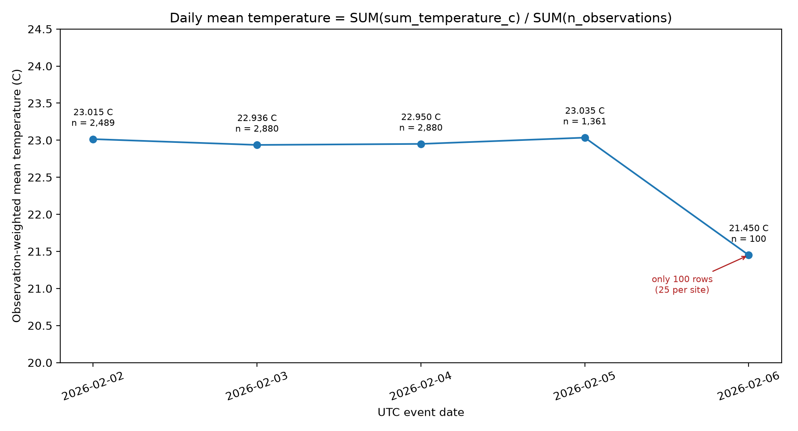
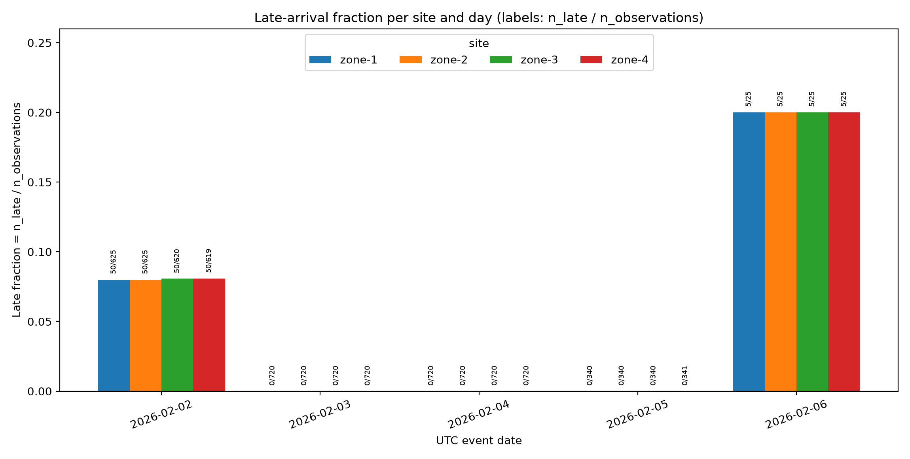

## 4. Analytics (Role D)

All values below are read from Gold version 1, computed from Silver version 1 (run `attempt-c02`). Source files: `evidence/Q1_site_day.json`, `evidence/Q2_weighted_day.json`, `evidence/Q3_above25_rate.json`. Plots: `evidence/daily_mean.png` and `evidence/late_fraction.png`. Gold and Silver exports of `attempt-c02` are byte-identical to those of the release run `attempt-e01`, so these results describe the same logical snapshot that the release candidate pins.

### Q1 - site/day KPIs

Q1 returns one row per site and UTC event date (4 sites x 5 days = 20 groups) with `n_observations`, `mean_temperature_c`, `n_late` and `late_rate`.

- **Completeness differs by day.** A full day has 720 observations per site (2,880 in total). 2026-02-03 and 2026-02-04 are full. 2026-02-02 has 625, 625, 620 and 619 observations, 2026-02-05 has 340, 340, 340 and 341, and 2026-02-06 has only 25 per site.
- **Site means are stable and ordered.** On 2026-02-02 to 2026-02-05 the site means stay in narrow bands: zone-1 22.29 to 22.39 C, zone-2 22.79 to 22.89 C, zone-3 23.29 to 23.40 C, zone-4 23.39 to 23.47 C, so zone-4 > zone-3 > zone-2 > zone-1 on every one of those days. On 2026-02-06 the means are 21.30, 21.60, 21.30 and 21.60 C, but they rest on 25 observations each and should not be read as a trend.
- **Late arrivals are concentrated.** Each site has 50 late rows on 2026-02-02 (late rate 0.0800 to 0.0808) and 5 of 25 on 2026-02-06 (0.2000); every other group has none.

### Q2 - observation-weighted mean vs mean of site means

| event_date | n_observations | weighted mean (C) | AVG of site means (C) | difference |
|---|---:|---:|---:|---:|
| 2026-02-02 | 2489 | 23.014665 | 23.016459 | +0.001794 |
| 2026-02-03 | 2880 | 22.936111 | 22.936111 | 0.000000 |
| 2026-02-04 | 2880 | 22.950000 | 22.950000 | 0.000000 |
| 2026-02-05 | 1361 | 23.034533 | 23.034212 | -0.000321 |
| 2026-02-06 | 100 | 21.450000 | 21.450000 | 0.000000 |

The observation-weighted daily mean for a date $d$ over sites $s$ is

$$\bar{T}_d = \frac{\sum_{s} \text{sum\_temperature\_c}_{s,d}}{\sum_{s} n_{s,d}}$$

whereas the naive mean of site means is

$$\tilde{T}_d = \frac{1}{4}\sum_{s} \bar{T}_{s,d}, \qquad \bar{T}_{s,d} = \frac{\text{sum\_temperature\_c}_{s,d}}{n_{s,d}}$$

$\tilde{T}_d$ gives every site/day group the same weight regardless of how many observations it holds, so $\tilde{T}_d = \bar{T}_d$ only when the site counts within the day are equal. This matches the table: the differences on 2026-02-02 (site counts 625, 625, 620, 619) and 2026-02-05 (340, 340, 340, 341) are non-zero, and the days with equal site counts show no difference at six decimals. $\bar{T}_d$ is the correct daily mean of the retained measurements. The total of the `n_observations` column is 9,710, equal to the Silver row count.

### Late fraction (numerator / denominator, summed over sites)

$$\text{late fraction}_d = \frac{\sum_s n_{\text{late},s,d}}{\sum_s n_{s,d}}$$

| event_date | n_late | n_observations | late fraction |
|---|---:|---:|---:|
| 2026-02-02 | 200 | 2489 | 0.080354 |
| 2026-02-03 | 0 | 2880 | 0.000000 |
| 2026-02-04 | 0 | 2880 | 0.000000 |
| 2026-02-05 | 0 | 1361 | 0.000000 |
| 2026-02-06 | 20 | 100 | 0.200000 |

Late rows occur only on 2026-02-02 and 2026-02-06. `is_late` is true only when ingest minus event time exceeds 900 seconds, and late rows are retained.

### Fraction above 25 C (numerator / denominator, summed over sites)

$$\text{above-25 fraction}_d = \frac{\sum_s n_{>25,s,d}}{\sum_s n_{s,d}}$$

| event_date | n_above_25 | n_observations | fraction |
|---|---:|---:|---:|
| 2026-02-02 | 739 | 2489 | 0.296906 |
| 2026-02-03 | 832 | 2880 | 0.288889 |
| 2026-02-04 | 841 | 2880 | 0.292014 |
| 2026-02-05 | 406 | 1361 | 0.298310 |
| 2026-02-06 | 0 | 100 | 0.000000 |

Daily fractions are sums of numerators over sums of denominators, not an average of site rates. By site, zone-3 has the highest exceedance rate (about 0.40 to 0.41 on 2026-02-02 to 2026-02-05), then zone-4 (about 0.36 to 0.37), while zone-1 and zone-2 stay near 0.20 to 0.21. 25 C is a teaching threshold, not a calibrated physical or safety threshold. The 0/100 on 2026-02-06 is a property of the 100 rows added by revision batch 02 (25 per site), not evidence of a temperature change.

### Figures

*Figure 1.* Source: Gold v1 built from Silver v1 (run `attempt-c02`). Each point is the observation-weighted mean $\bar{T}_d$ with its observation count $n$. Days 2026-02-02 (2,489), 2026-02-05 (1,361) and 2026-02-06 (100) have fewer than the 2,880 observations of a full day, so the drop on 2026-02-06 rests on 100 rows and is not a trend. Values are observed temperatures, not QA-corrected.

*Figure 2.* Source: Gold v1 built from Silver v1 (run `attempt-c02`). Bar labels are `n_late / n_observations` for each site and day. Late rows (ingest minus event greater than 900 s) are retained, and they occur only on 2026-02-02 and 2026-02-06; 2026-02-06 has only 25 observations per site.

### Residual quality limitations

- Values are the released observed temperatures. They are not corrected with the QA reference sample, and a range-valid value can still disagree with that sample.
- Days are not equally complete: 2026-02-02 (2,489), 2026-02-05 (1,361) and 2026-02-06 (100) have fewer observations than the 2,880 of a full day, so daily comparisons are not comparisons of equally complete days.
- The 100 rows of 2026-02-06 are the only rows beyond the 9,610 handoff rows; statistics for that day rest on a very small sample.
- The fixture is a bounded teaching dataset, not production-scale evidence.
